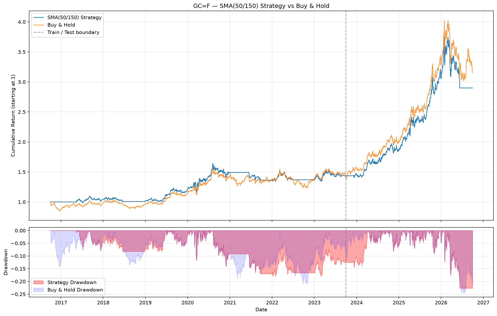
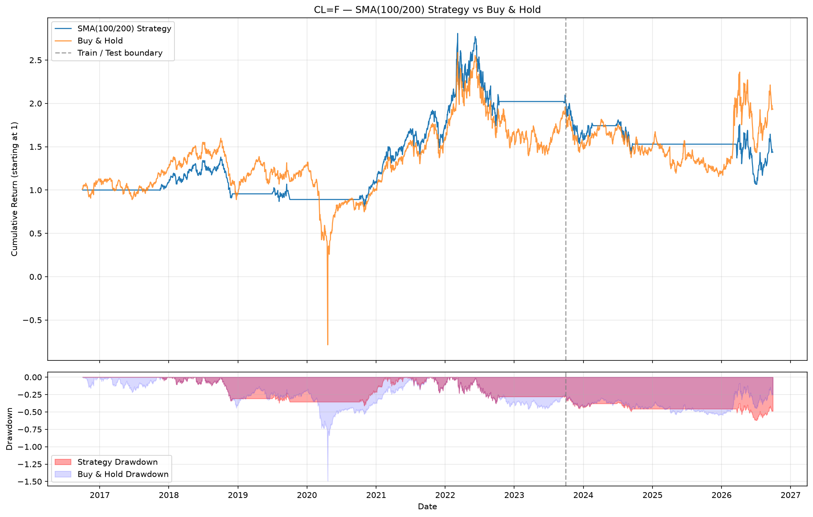

# Moving-Average Trend-Following Backtest on Commodity Futures

## Project Overview

This project backtests a simple moving-average (SMA) crossover trend-following
strategy on two commodity futures — **Gold (GC=F)** and **Crude Oil (CL=F)** —
using ~10 years of daily closing prices from Yahoo Finance.

The goal is to determine whether a mechanical, rules-based trend-following
approach can outperform a passive buy-and-hold benchmark on commodity markets,
while being simple enough to explain line by line in an interview.

## Method

| Step | Detail |
|------|--------|
| **Data** | ~10 years of daily adjusted close prices via `yfinance` |
| **Signal** | Long (1) when short SMA > long SMA, else flat (0) |
| **Look-ahead guard** | Signal shifted by 1 day (`signal.shift(1)`) |
| **Transaction cost** | 0.05% (5 bps) deducted each time position changes |
| **Train/Test split** | Train: first 7 years (Sep 2016 – Sep 2023), Test: last 3 years (Sep 2023 – Sep 2026) |
| **Parameter tuning** | Grid search short ∈ {20, 50, 100}, long ∈ {100, 150, 200} (short < long), best by Sharpe on train only |
| **Benchmark** | Buy-and-hold on the same asset |

### Best Parameters (selected on training data)

| Asset | Best Short Window | Best Long Window | Train Sharpe |
|-------|:-:|:-:|:-:|
| Gold (GC=F) | 50 | 150 | 0.44 |
| Crude Oil (CL=F) | 100 | 200 | 0.41 |

## Results

All numbers below are computed from real Yahoo Finance data downloaded on 2026-09-29.

### Performance Metrics

| Asset \| Period \| Type | Ann. Return | Ann. Volatility | Sharpe Ratio | Max Drawdown | Win Rate | Trades |
|---|---|---|---|---|---|---|
| GC=F \| Train \| Strategy | 5.34% | 12.14% | 0.44 | -18.24% | 53.89% | 16 |
| GC=F \| Train \| Buy & Hold | 5.17% | 14.56% | 0.36 | -21.19% | 52.98% | - |
| GC=F \| Test \| Strategy | 26.41% | 19.94% | 1.32 | -22.68% | 56.42% | 2 |
| GC=F \| Test \| Buy & Hold | 30.58% | 21.60% | 1.42 | -24.94% | 56.04% | - |
| CL=F \| Train \| Strategy | 10.86% | 26.58% | 0.41 | -41.15% | 56.35% | 7 |
| CL=F \| Train \| Buy & Hold | 9.78% | 134.46% | 0.07 | -149.25% | 55.57% | - |
| CL=F \| Test \| Strategy | -11.22% | 30.63% | -0.37 | -47.56% | 49.32% | 4 |
| CL=F \| Test \| Buy & Hold | 0.28% | 41.05% | 0.01 | -39.31% | 50.73% | - |

### Key Observations

**Gold (GC=F):** On the test set, the SMA(50/150) strategy returned 26.41%
annualized vs 30.58% for buy-and-hold. The strategy **slightly underperformed**
but did reduce volatility (19.94% vs 21.60%) and max drawdown (-22.68% vs
-24.94%). The strategy stayed long for most of the test period (only 2 trades).

**Crude Oil (CL=F):** On the test set, the SMA(100/200) strategy **lost -11.22%
annualized** while buy-and-hold was roughly flat (+0.28%). The strategy's very
long lookback windows were too slow to adapt to the choppy, range-bound oil
market of 2023–2026. However, during training, the strategy brilliantly avoided
the 2020 oil crash (note the -149.25% drawdown for buy-and-hold vs -41.15% for
the strategy).

## Charts

### Gold (GC=F) — SMA(50/150) Strategy vs Buy & Hold



### Crude Oil (CL=F) — SMA(100/200) Strategy vs Buy & Hold



## Limitations

1. **Yahoo Finance continuous futures do not handle contract rolls.**
   The `GC=F` and `CL=F` tickers are unadjusted front-month continuous
   contracts. They do not account for the price jumps that occur when the
   front-month contract expires and rolls to the next. In a real trading
   system, you would use a properly roll-adjusted continuous series (e.g.,
   back-adjusted or ratio-adjusted) to avoid spurious signals and inflated
   returns.

2. **Sensitivity to parameters.**
   The strategy's performance is highly sensitive to the choice of short and
   long SMA windows. The best parameters found on training data (SMA 50/150
   for gold, SMA 100/200 for oil) did not generalize equally well to the test
   period. This is a common problem with optimized technical strategies — what
   worked in-sample may not work out-of-sample.

3. **Transaction cost simplification.**
   The flat 0.05% (5 bps) cost per trade is a rough approximation. Real
   trading costs include bid-ask spreads (which vary with market conditions
   and liquidity), exchange fees, clearing fees, broker commissions, and
   slippage. Futures also require margin, and the cost of capital is not
   modeled here.

4. **Past performance does not predict future returns.**
   This backtest is an educational exercise. Historical backtest results —
   especially on a single strategy with optimized parameters — should not
   be extrapolated to future live trading. Markets are non-stationary, and
   regime changes can make previously profitable strategies unprofitable.

## How to Run

1. Open the notebook in [Google Colab](https://colab.research.google.com/).
2. Run all cells (Runtime → Run all).
3. The notebook will download data, run the grid search, backtest, and display
   results and charts inline.

Alternatively, run the standalone script:

```bash
pip install yfinance pandas numpy matplotlib
python backtest.py
```

## Dependencies

- Python 3.8+
- `yfinance`
- `pandas`
- `numpy`
- `matplotlib`
